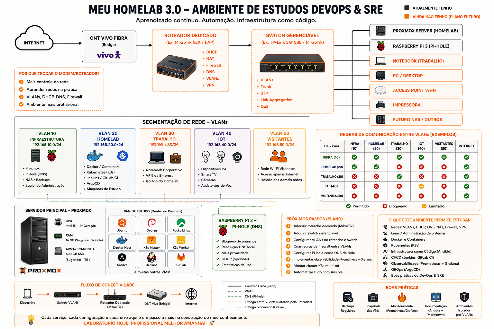

# Arquitetura do Homelab

## Visão Geral da Infraestrutura

Esta imagem representa a arquitetura completa do ambiente de estudos DevOps & SRE, incluindo:

### Componentes Principais

- **Proxmox Server**: Servidor principal de virtualização
- **Raspberry Pi 3**: Node adicional no cluster
- **Roteador Dedicado**: Mikrotik hEX para controle de rede
- **Switch Gerenciável**: TP-Link SG108E para segmentação

### Segmentação de Rede (VLANs)

- **VLAN 10**: Infraestrutura (192.168.10.0/24)
- **VLAN 20**: Homelab (192.168.20.0/24)  
- **VLAN 30**: Trabalho (192.168.30.0/24)
- **VLAN 40**: IoT (192.168.40.0/24)
- **VLAN 50**: Visitantes (192.168.50.0/24)

### Próximos Passos Planejados

- Implementar observabilidade (Prometheus/Grafana)
- Configurar GitOps com Ansible
- Adicionar switches gerenciáveis
- Implementar cluster K3s distribuído